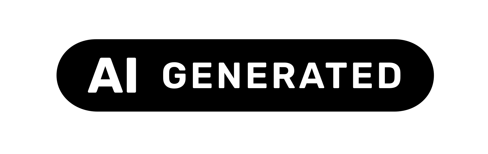

# agent-critical-thinking-skills

[](https://github.com/aleknitka/agent-critical-thinking-skills/releases) [](https://www.skills.sh/aleknitka/agent-critical-thinking-skills) [](LICENSE) [](https://code.claude.com/docs/en/plugin-marketplaces) [](https://developers.openai.com/codex/skills) [](https://openai.github.io/openai-skills)

> **Make any AI a sharper judge.** 8 evaluative methods + a router — the 5th bucket `sharper judgment` — that turn "is this credible / does this follow / what are we missing" into a scorecard, a map, a bias scan, or a priced bet — plus the probe that proves it.


Every method: one instruction → a concrete artifact → a tiny experiment you can run tomorrow. Works with Claude Code, Codex, OMP, Pi — any skills harness.

## Install

```bash
# Claude Code
/plugin marketplace add aleknitka/agent-critical-thinking-skills
/plugin install critical-thinking-skills@agent-critical-thinking-skills
# OMP / Codex / Pi (same catalog)
npx skills add aleknitka/agent-critical-thinking-skills
```

Then: `> Help me think critically about this claim — not sure which method fits.` → router shortlists 1–2 methods.

**Try without an agent (offline, no network):**

```bash
uv run python plugins/critical-thinking-skills/skills/thinking-router/scripts/route.py --text "is this source credible, does the argument follow?"
uv run python plugins/critical-thinking-skills/skills/evidence-appraisal/scripts/evidence.py --claim "X reduces Y by 20%" --tier rct --n 200 --json
# → strength 1–5 + next probe  (--json for deterministic helpers)
```

## Why this, not just "more ideas"?

Creative gives you breadth. This gives you accountability — fewer, sharper judgments before you commit.

- **Routed, not scattered.** 5-bucket router (`sharper judgment` + 4 creative buckets) picks 1–2 methods so you don't browse 9 tabs.
- **Artifact, not advice.** Each skill ends in something checkable — a tier→strength scorecard, a Toulmin map, a 40-tag bias scan, a Brier score, an EV sheet — plus the probe.
- **Offline & deterministic.** Helpers use `--json` where supported, no network — same input, same score.
- **Human + agent board.** `workspace/index.html` — sticky notes, lanes, votes — both sides read/write `workspace/boards/<id>.json`.

Not for one-off polish, validated simulation, or replacing real interviews. See each skill's `references/provenance.md`.

## In 60 seconds

1. One sentence about what's at stake → router returns *Primary / Alternate / Not now*.
2. Run the skill (10 min) → one claim + source → scorecard / map / posterior + next probe.
3. Ship a probe: "Holdout one cohort; if lift <2pp at p>0.2, keep the sceptical hypothesis."

Full triggers: [`thinking-router/references/catalog.md`](plugins/critical-thinking-skills/skills/thinking-router/references/catalog.md).

## Toolkit — 8 skills + a router

Every skill is `SKILL.md` → `references/*.md` → `scripts/*.py`. No worksheets.

| Bucket | What you get | When to reach for it |
|---|---|---|
| **Sharper judgment** (3) | Soundness check — evidence appraisal, argument map, fallacy scan | Is this credible / does it follow? |
| **Better question** (1) | Operational definition — socratic elenchus | A term is vague |
| **Broader perspectives** (1) | Counter-view — steelman & red-team | Your critique feels weak |
| **Stronger options** (3) | Priced bets — Bayesian updating, Brier/calibration, EV + sensitivity | Which bet is best under uncertainty? |

<details>
<summary>Full list with sources</summary>

- **Sharper judgment:** `evidence-appraisal` (Facione/Paul–Elder/Ioannidis) · `argument-mapping` (Toulmin/Walton) · `fallacy-bias-spotting` (Kahneman/Tversky — 20 fallacies × 20 biases)
- **Better question:** `socratic-elenchus` (Paul–Elder/Ennis)
- **Broader perspectives:** `steelman-red-team` (Zenko/Tetlock)
- **Stronger options:** `bayesian-updating` (Bayes/Tetlock) · `calibration-forecasting` (Brier) · `decision-analysis` (Howard & Matheson) — see `references/provenance.md` in each skill

</details>

| | What it does | When |
|---|---|---|
| `thinking-router` | Scores 5 buckets → Primary / Alternate / Not now | "Not sure which method fits" |
| **Workspace** | Browser board — notes, lanes, drawing, votes, timer, file I/O | Human + agent on one board |

9 critical templates + 18 creative = 27 total (`workspace/boards/_schema.json`).

## Gallery — copy-paste prompts

Start here: [`examples/gallery.md`](examples/gallery.md) — 60-s quick start → one prompt per bucket → `router → skill → probe`.

```bash
uv run python plugins/critical-thinking-skills/skills/thinking-router/scripts/route.py --text "is this source credible, does the argument follow?"
```

More: `evidence-appraisal/scripts/evidence.py` · `fallacy-bias-spotting/scripts/fallacy.py --list` — see `examples/gallery.md`.

## Who this is for (and not for)

**For:** product, design, research, strategy, teaching, ops — solo or team — anyone who wants a sharper judge in the room.

**Not for:** replacing interviews or validated models. Skills produce *hypotheses with a probe* — they clarify the next check, not the answer.

## Status, licence, and maintenance

- **Status:** `0.9.0` — breaking changes bump minor pre-1.0. Every skill ships with `references/provenance.md`.
- **Licence:** MIT · **Requires:** `uv` or Python ≥3.13; Claude Code / Codex / OMP / Pi for auto-loading; any modern browser for the workspace.
- **Releases:** [`CHANGELOG.md`](CHANGELOG.md) · `scripts/validate.py` gates releases.

---

## Transparency · AI disclosure — EU AI Act Art. 50

**Human-guided, ~95% AI-generated — OMP + Meta Muse Spark (muse-spark-1.2).** Docs, skills, and film were built with AI under human guidance and review. Author remains responsible.

[](https://digital-strategy.ec.europa.eu/en/policies/eu-icons-labelling-ai-generated-content) Voluntary use of the [EU official icons](https://digital-strategy.ec.europa.eu/en/policies/eu-icons-labelling-ai-generated-content) ([Art. 50](https://artificialintelligenceact.eu/article/50) · [Code of Practice §2](https://digital-strategy.ec.europa.eu/en/policies/code-practice-ai-generated-content), enforceable 2 Aug 2026) — `AI GENERATED` at [`assets/eu-ai/`](assets/eu-ai/) · also on the film end card. Badges via [AI Disclosure Badges](https://disclosingai.com/) (CC0) …

---

## Contributing & docs

- Rules: [`CLAUDE.md`](CLAUDE.md) · New skill: `cp -r templates/skill plugins/critical-thinking-skills/skills/<name>` → `python3 scripts/validate.py`
